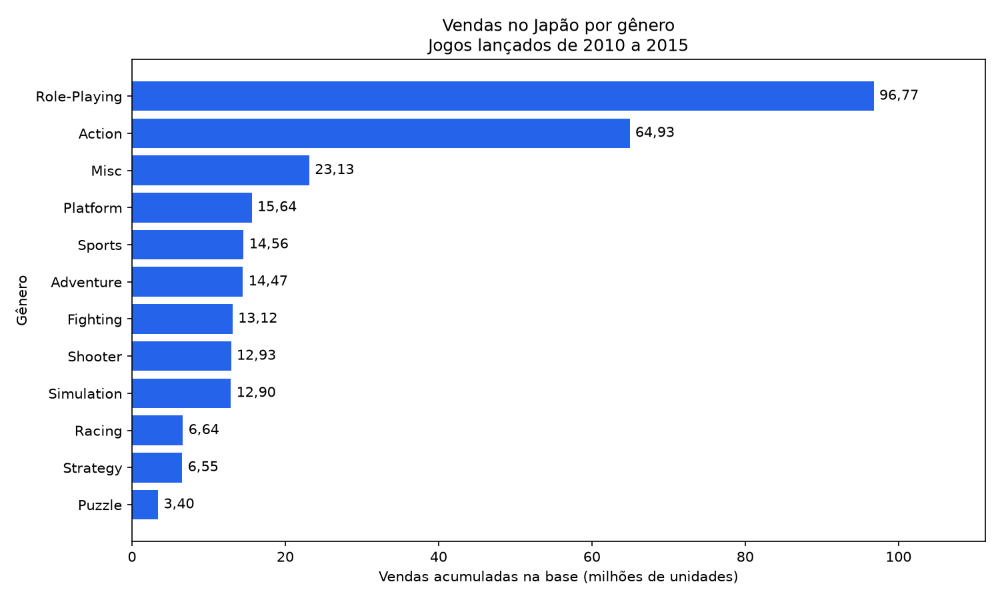
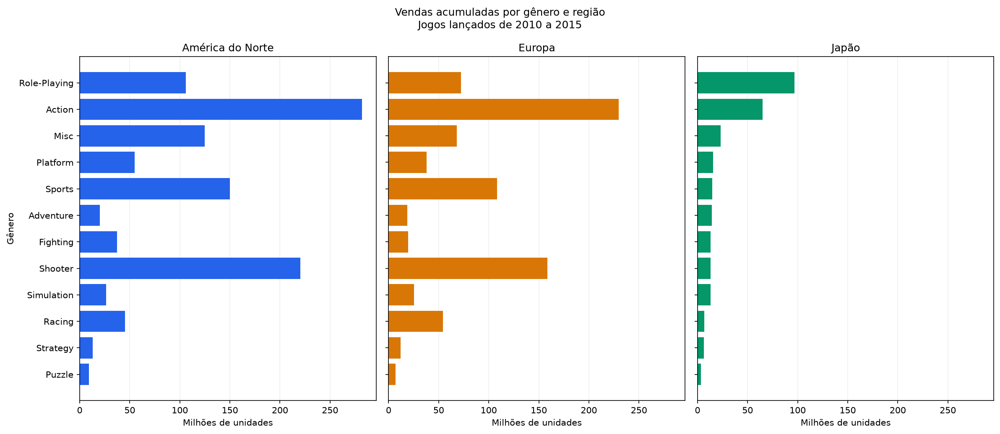

# Análise de vendas de videogames 🎮

Projeto de análise de dados que combina **Python, Pandas, PostgreSQL, SQL e Matplotlib** para comparar as vendas de jogos por gênero e região. O recorte principal considera jogos lançados de **2010 a 2015** e as regiões América do Norte, Europa e Japão.

## Pergunta da análise

Quais gêneros acumularam mais vendas em cada região entre os jogos do recorte? O projeto importa os dados para um banco PostgreSQL, agrupa as vendas com SQL e apresenta os resultados em tabelas e gráficos.





## Resultados

O arquivo original tem **16.598 registros**; **4.797** possuem ano de lançamento entre 2010 e 2015. Nesse recorte, os maiores totais da base foram:

| Região | Gênero com mais vendas | Vendas acumuladas |
| --- | --- | ---: |
| América do Norte | Action | 281,91 milhões de unidades |
| Europa | Action | 229,91 milhões de unidades |
| Japão | Role-Playing | 96,77 milhões de unidades |

Os valores são somas dos registros da base para o período, não vendas atuais nem uma estimativa de todo o mercado.

## Etapas do projeto

1. **Exploração:** leitura do CSV e verificação de tipos, dimensões e dados ausentes com Pandas.
2. **Tratamento:** preservação dos **271 anos ausentes** como valores nulos e preenchimento das **58 publicadoras ausentes** com `Não informado`.
3. **Carga:** importação dos registros para a tabela `vendas_jogos` no PostgreSQL.
4. **Consulta:** agregação das vendas por gênero e região com `SUM`, `GROUP BY` e filtro de ano entre 2010 e 2015.
5. **Visualização:** gráfico horizontal para o Japão e comparativo entre América do Norte, Europa e Japão.

As colunas de vendas do dataset representam **milhões de unidades**. A consulta também calcula `outras_regioes`, exibida na tabela do terminal; o gráfico comparativo mostra as três regiões selecionadas.

## Estrutura

```text
analise-videogames/
├── README.md
├── requirements.txt
├── schema.sql
├── analise.py
├── conexao.py
├── importar_dados.py
├── consultar_vendas.py
└── graficos/
    ├── vendas_genero_japao.png
    └── comparativo_regioes.png
```

`vgsales.csv` deve ser baixado separadamente e colocado na raiz do projeto. Ele não está incluído no repositório.

## Como executar

**Pré-requisitos:** Python 3, PostgreSQL em execução na máquina local e acesso à conta `postgres`. Os scripts usam `localhost:5432` e solicitam a senha no terminal, sem gravá-la nos arquivos.

1. Baixe o arquivo `vgsales.csv` no [dataset Video Game Sales do Kaggle](https://www.kaggle.com/datasets/gregorut/videogamesales) e coloque-o na mesma pasta dos scripts.
2. Na pasta do projeto, crie um ambiente virtual e instale as dependências:

   ```powershell
   python -m venv .venv
   .\.venv\Scripts\Activate.ps1
   python -m pip install -r requirements.txt
   ```

   No Linux ou macOS, a ativação do ambiente é `source .venv/bin/activate`.

3. Crie o banco `analise_videogames` no PostgreSQL. No **pgAdmin**, execute `CREATE DATABASE analise_videogames;` conectado a outro banco, como `postgres`. Depois, abra a ferramenta de consultas no novo banco e execute o conteúdo de `schema.sql` para criar a tabela.

   Se você usa `psql`, pode fazer as duas etapas com:

   ```bash
   psql -U postgres -d postgres -c "CREATE DATABASE analise_videogames;"
   psql -U postgres -d analise_videogames -f schema.sql
   ```

4. Execute os scripts nesta ordem:

   ```bash
   python analise.py
   python importar_dados.py
   python conexao.py
   python consultar_vendas.py
   ```

`analise.py` explora o CSV; `importar_dados.py` faz a carga; `conexao.py` confirma a quantidade de linhas no banco; `consultar_vendas.py` imprime a consulta e salva os gráficos em `graficos/`. Os três scripts que acessam o banco pedem a senha do PostgreSQL. A importação é ignorada se a tabela já tiver qualquer registro.

## Fonte e limites

Dados: [Video Game Sales, publicado por Gregory Smith no Kaggle](https://www.kaggle.com/datasets/gregorut/videogamesales). A análise usa uma base histórica e um recorte por ano de lançamento; títulos com ano ausente ficam fora da consulta de 2010 a 2015. Os totais não devem ser tratados como retrato completo do mercado ou previsão de vendas.

**Autor:** [Pedro Henrique Spagnuolo Fernandes](https://github.com/pedrospag)
